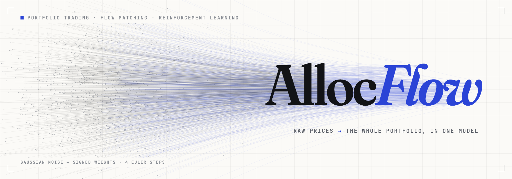
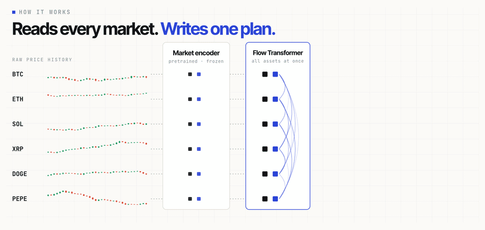
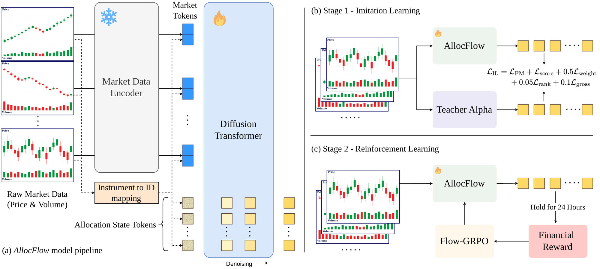
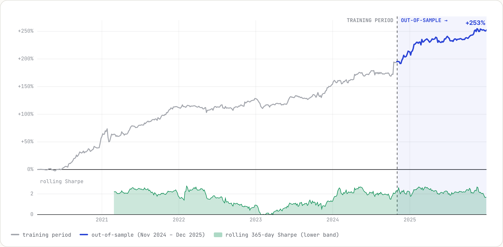

<p align="center">
  <a href="https://allocflow.github.io/"></a>
</p>

<h3 align="center">End-to-End Portfolio Trading Action Generation from Raw Market Data</h3>

<p align="center">
<a href="https://scholar.google.com/citations?user=vZn0gL8AAAAJ&hl=en">Annan Wang</a><sup>1,*</sup> ·
<a href="https://aresxie.top/">Yuchen Xie</a><sup>1,*</sup> ·
<a href="https://www.linkedin.com/in/yu-cen-2999691a1/">Yu Cen</a><sup>2</sup> ·
<a href="https://cliangyu.com/">Leon Liangyu Chen</a><sup>3</sup> ·
<a href="https://qianyu-zhu.github.io/">Qianyu Julie Zhu</a><sup>4</sup> ·
<a href="https://lixin.ai/">Xin Li</a><sup>1</sup> ·
<a href="https://wtybest.github.io/">Tianyi Wei</a><sup>1</sup> ·
<a href="https://personal.ntu.edu.sg/wslin/Home.html">Weisi Lin</a><sup>1,†</sup>
</p>

<p align="center">
<sup>1</sup>Nanyang Technological University &nbsp;·&nbsp; <sup>2</sup>Independent Researcher &nbsp;·&nbsp; <sup>3</sup>Stanford University &nbsp;·&nbsp; <sup>4</sup>MIT
<br><sub><sup>*</sup>Equal contribution &nbsp;·&nbsp; <sup>†</sup>Corresponding author</sub>
</p>

<p align="center">
  <a href="https://allocflow.github.io/"></a>
  <a href="https://allocflow.github.io/#video"></a>
  <a href="https://arxiv.org/abs/2611.19937"></a>
  <a href="#citation"></a>
</p>

## 📰 News

- **[2026.11]** 🔥 We release the [paper](https://arxiv.org/abs/2611.19937), [project page](https://allocflow.github.io/) and [video](https://allocflow.github.io/#video) of AllocFlow!

## 💡 TL;DR

Most trading systems are relays: one model forecasts, another ranks, and rules size the trades. No step is trained on the final profit. **AllocFlow** replaces the relay with a single generative policy. It reads the raw hourly bars of every asset and generates the **whole signed portfolio at once** with flow matching. It learns in two stages: imitation first, then group-relative RL on portfolio-level rewards.

<p align="center">
  <a href="https://allocflow.github.io/#video"></a>
  <br><sub>From the <a href="https://allocflow.github.io/#video">explainer video</a>: raw prices → frozen market encoder → cross-asset flow Transformer → a balanced long/short book.</sub>
</p>

## 🧭 Method

<p align="center"></p>

| | What happens |
|:--|:--|
| **Read** | A frozen, pretrained [Kronos](https://github.com/shiyu-coder/Kronos) encoder turns each asset's raw hourly bars into two tokens. |
| **Generate** | A DiT-style flow head attends across all assets and transports Gaussian noise to signed target weights for the whole book. Inference takes **four Euler steps**. |
| **Imitate** | Stage 1 imitates a causal alpha strategy, so the generated books start out sensible. |
| **Refine** | Stage 2 ([Flow-GRPO](https://github.com/yifan123/flow_grpo)) samples **8 candidate books** per market state and scores each over the next **24 hourly bars**. It then moves toward the better ones, while a frozen copy of the stage-1 policy keeps it anchored. |

## 📈 Results

Hourly crypto perpetual futures · the 20 most-traded assets, reconstituted weekly · out-of-sample **Nov 2024 – Dec 2025** · 5 bps per unit traded · fixed-notional ledger.

| Policy | Return % ↑ | Max DD % ↓ | Sharpe ↑ | Calmar ↑ | Daily turnover |
|:--|--:|--:|--:|--:|--:|
| AlphaGen | 35.42 | 20.60 | 1.242 | 1.720 | 0.248 |
| AlphaSAGE | 31.30 | 23.36 | 1.396 | 1.340 | 1.255 |
| R&D-Agent-Quant | 20.69 | 18.53 | 0.967 | 1.117 | 0.397 |
| AlphaAgent | 29.12 | 26.93 | 1.048 | 1.081 | 0.651 |
| AgenticAlpha *(teacher)* | 33.92 | 19.57 | 1.472 | 1.733 | — |
| AllocFlow (imitation only) | 27.79 | 29.10 | 0.954 | 0.955 | 1.143 |
| **AllocFlow (imitation + RL)** | **51.38** ± 2.04 | **12.81** ± 1.51 | **2.192** ± 0.086 | **4.043** ± 0.379 | 1.976 ± 0.047 |

<p align="center"></p>
<p align="center"><sub>Cumulative PnL after costs (fixed notional, one training run). The shaded region is out of sample.</sub></p>

**It holds up on new data.** The same policy, without retraining, on six more unseen months:

| Period | Return % | Max DD % | Sharpe | Calmar |
|:--|--:|--:|--:|--:|
| Nov 2024 – Dec 2025 | 51.38 | 12.81 | 2.192 | 4.043 |
| Jan – Jun 2026 | **62.53** | **12.77** | 2.06 | **4.90** |

More results and ablations are in the [paper](https://arxiv.org/abs/2611.19937), and an interactive flow-matching demo is on the [project page](https://allocflow.github.io/).

## Citation

If you find AllocFlow useful, please consider starring the repo and citing:

```bibtex
@article{wang2026allocflow,
  title   = {AllocFlow: End-to-End Portfolio Trading Action Generation from Raw Market Data},
  author  = {Annan Wang and Yuchen Xie and Yu Cen and Leon Liangyu Chen and Qianyu Julie Zhu and Xin Li and Tianyi Wei and Weisi Lin},
  journal = {arXiv preprint arXiv:2611.19937},
  year    = {2026}
}
```

## Acknowledgements

AllocFlow builds on [Kronos](https://github.com/shiyu-coder/Kronos) for market representations and [Flow-GRPO](https://github.com/yifan123/flow_grpo) for RL on flow models. We thank their authors for releasing their work.

<sub>All results are historical backtests and are not investment advice.</sub>
